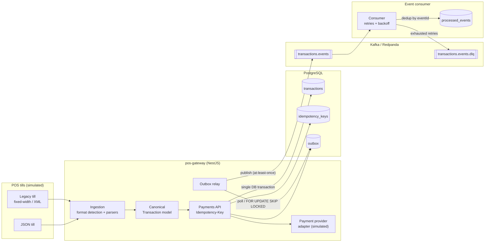

# pos-gateway

> **Status: design phase.** This repository currently contains the design and the task plan. Application code lands milestone by milestone — see the [Roadmap](#roadmap).

A TypeScript backend that sits between point-of-sale (POS) tills and a payments core. Tills send sales in modern JSON or in legacy formats (fixed-width records, XML); the gateway normalises everything into one canonical transaction model, processes payments safely under retries, and publishes transaction lifecycle events that downstream services can consume reliably.

The domain is modelled on **mobility and EV-charging style payments**: unattended or attended tills at parking sites, fuel/charging stations and shops, where networks are flaky, clients retry aggressively, and every charge must happen **exactly once from the customer's point of view**.

It's a personal learning and showcase project: not used in production, with no real merchants, users or card data. It focuses on the unglamorous parts that make payment systems trustworthy: idempotency, the transactional outbox, at-least-once delivery, idempotent consumers and dead-letter handling.

## Contents

- [Goals](#goals)
- [Architecture](#architecture)
- [Canonical model](#canonical-model)
- [API sketch](#api-sketch)
- [Idempotency and delivery guarantees](#idempotency-and-delivery-guarantees)
- [Tech stack](#tech-stack)
- [Running locally (planned)](#running-locally-planned)
- [Roadmap](#roadmap)

## Goals

- **Multi-format ingestion** – accept sales from a fictional POS till as JSON and as legacy fixed-width / XML payloads, and map them to a single canonical model with strict validation.
- **Safe payments API** – a NestJS API backed by PostgreSQL where every mutating request carries an `Idempotency-Key`; retries never double-charge.
- **Reliable events** – `transaction.authorized`, `transaction.captured` and `transaction.failed` events published to Kafka (Redpanda locally) through a **transactional outbox**.
- **Resilient consumption** – a consumer with bounded retries, exponential backoff, a dead-letter topic and de-duplication on consume.
- **Extensible** – each till format is a self-contained adapter module; adding a new POS format shouldn't touch the payments core.
- **Operable** – Docker Compose, liveness/readiness probes, integration tests with Testcontainers and simple Kubernetes manifests.

Non-goals: a frontend, a real card network/acquirer integration, handling raw card data (the payment provider is simulated and only returns tokens).

## Architecture



**Flow, in short**

1. A till posts a sale (`application/json`, `application/xml` or `text/plain` fixed-width).
2. Ingestion detects the format, parses and validates it, and produces a canonical `Transaction`.
3. The payments API authorises/captures via a simulated provider. State change, idempotency record and outbox row are written in **one** PostgreSQL transaction.
4. The outbox relay publishes pending rows to Kafka and marks them sent.
5. The consumer processes events idempotently; failures are retried with backoff and eventually parked in the DLQ.

## Canonical model

All input formats map into one model. Amounts are integer **minor units** (cents) to avoid floating-point errors; currencies are ISO 4217.

```ts
type TransactionStatus = 'PENDING' | 'AUTHORIZED' | 'CAPTURED' | 'FAILED';

interface Transaction {
  id: string;                    // UUID, gateway-generated
  merchantId: string;
  siteId: string;                // e.g. parking site / charging station
  terminalId: string;            // till id
  externalRef: string;           // till receipt / sale number
  occurredAt: string;            // ISO 8601, UTC
  currency: string;              // ISO 4217, e.g. "EUR"
  totalMinor: number;            // sum of lines incl. tax, in minor units
  taxMinor: number;
  lines: TransactionLine[];
  payment: {
    method: 'CARD' | 'WALLET' | 'FLEET_CARD';
    paymentToken: string;        // tokenised reference from the provider; never a PAN
    cardBrand?: string;          // e.g. "VISA", for display/reporting only
  };
  status: TransactionStatus;
  source: { format: 'json' | 'fixed-width' | 'xml'; schemaVersion: string };
}

interface TransactionLine {
  sku: string;                   // e.g. "EV-KWH", "PARKING-HOUR"
  description: string;
  quantity: number;              // decimal allowed, e.g. kWh
  unit: 'ITEM' | 'KWH' | 'MINUTE' | 'LITRE';
  unitPriceMinor: number;
  taxRateBps: number;            // basis points, 2300 = 23%
}
```

**Legacy fixed-width sketch** (one header record `H`, n line records `L`; positions documented in `docs/formats/` as part of M1):

```
H|TERM0001|SITE042|20261015T143000Z|EUR|R000123
L|EV-KWH      |000018.500|000000045|2300
```

The real fixed-width format is column-positioned rather than pipe-delimited; the pipes above are only for readability.

### Adding a POS format

Parsers implement one small interface and register themselves with the ingestion module, so a new till format is one module plus fixtures:

```ts
interface PosFormatAdapter {
  readonly format: string;                          // e.g. "xml"
  canHandle(contentType: string, raw: Buffer): boolean;
  parse(raw: Buffer): ParseResult<Transaction>;     // typed errors, no throwing on bad input
}
```

A step-by-step guide (`docs/adding-a-pos-format.md`) is planned as part of M1.

## API sketch

| Method | Path | Notes |
| --- | --- | --- |
| `POST` | `/v1/sales` | Ingest a sale in JSON, XML or fixed-width (by `Content-Type`). Requires `Idempotency-Key`. |
| `POST` | `/v1/payments/{transactionId}/authorize` | Authorise against the simulated provider. Requires `Idempotency-Key`. |
| `POST` | `/v1/payments/{transactionId}/capture` | Capture an authorised payment. Requires `Idempotency-Key`. |
| `GET` | `/v1/transactions/{id}` | Read the canonical transaction and its status. |
| `GET` | `/health/live` | Liveness: process is up. |
| `GET` | `/health/ready` | Readiness: PostgreSQL and Kafka reachable. |

```http
POST /v1/sales
Content-Type: application/json
Idempotency-Key: 6f1c2b8e-1d5a-4a7e-9b1e-2f0c3d4e5a6b

{ "terminalId": "TERM0001", "siteId": "SITE042", "externalRef": "R000123", ... }
```

Responses:

- `201 Created` – first successful processing.
- Same status and body, plus `Idempotent-Replayed: true` – a retry with the same key and the same payload.
- `409 Conflict` – the same key is currently being processed by another request.
- `422 Unprocessable Entity` – the same key was reused with a **different** payload.
- `400 Bad Request` – the payload fails parsing or validation (errors point at the offending field/column).

## Idempotency and delivery guarantees

### Idempotent requests

Tills retry on timeouts, so the API must tolerate the same request arriving more than once, even concurrently.

- **Key + scope.** Every mutating request carries an `Idempotency-Key` header. Keys are unique per `(merchant, key)`, enforced by a **unique constraint** in PostgreSQL, not by application checks.
- **Request fingerprint.** We store a SHA-256 hash of the method, path and canonicalised body. Same key with a different fingerprint → `422`, so a key can't be accidentally reused for a different sale.
- **Stored response.** Once processing finishes, the status code and response body are stored with the key. Retries get the original response replayed, without touching the provider again.
- **Concurrency.** The first request claims the key by inserting it with state `IN_PROGRESS` (`INSERT ... ON CONFLICT DO NOTHING`). A concurrent duplicate that loses the race gets `409` and may retry later. Stale `IN_PROGRESS` claims (crashed workers) can be taken over after a lock timeout.
- **Atomicity.** The business state change, the idempotency record update and the outbox row commit in the **same** database transaction.
- **Retention.** Keys expire after a configurable window (e.g. 24h) and are cleaned up by a scheduled job.

### Transactional outbox

Writing to the database and publishing to Kafka can't be done atomically, so we avoid the dual write:

1. In the same transaction as the state change, insert an `outbox` row (`event_id`, `aggregate_id`, `type`, `payload`, `created_at`, `published_at NULL`).
2. A relay polls unpublished rows with `SELECT ... FOR UPDATE SKIP LOCKED` (several relay instances can run safely), publishes them to Kafka with the transaction id as the message key (per-transaction ordering), then sets `published_at`.
3. If the relay crashes after publishing but before marking the row, the event is published again. That's expected: the system is **at-least-once**.

### At-least-once delivery and dedup on consume

Duplicates are a given, so consumers are idempotent:

- Every event carries a stable `eventId` (UUID from the outbox row).
- The consumer records processed ids in a `processed_events` table **in the same transaction** as its side effects; a duplicate hits the primary key and is skipped.
- Offsets are committed **after** successful processing, never before.

Together, the outbox and idempotent consumers give **effectively-once processing** without relying on distributed transactions.

### Retries, backoff and DLQ

- Transient errors (DB timeouts, downstream 5xx) are retried with **exponential backoff and jitter**, up to a bounded number of attempts.
- Permanent errors (schema violations, unknown event types) skip the retries.
- Messages that exhaust retries or fail permanently go to `transactions.events.dlq` with the original payload and headers describing the error, attempt count and source offset, so they can be inspected and replayed by a script.

### Event contract

```json
{
  "eventId": "b3e1…",
  "type": "transaction.captured",
  "occurredAt": "2026-10-15T14:30:05Z",
  "transactionId": "9a7c…",
  "schemaVersion": 1,
  "data": { "amountMinor": 832, "currency": "EUR", "siteId": "SITE042" }
}
```

Event types: `transaction.authorized`, `transaction.captured`, `transaction.failed`.

### PCI-aware design notes

These are design notes for a learning project. The aim is to keep the gateway out of card-data scope by design:

- The gateway **never receives or stores a PAN**, CVV or track data. Tills (and the simulated provider) hand over a **tokenised payment reference**, and that token is the only payment credential persisted.
- Ingestion rejects payloads that look like they contain a full card number (Luhn-valid 13–19 digit sequences) instead of storing them.
- Structured logs go through a **redaction** step: tokens are truncated, and fields such as `pan`, `cvv` and `track` are dropped. Request bodies are never logged verbatim.

## Tech stack

- **Language/runtime:** TypeScript, Node.js LTS
- **Framework:** NestJS
- **Database:** PostgreSQL (migrations versioned in the repo; indexes on idempotency-key and transaction lookups, plus an optional read-through cache for `GET /v1/transactions/{id}`)
- **Messaging:** Kafka protocol, using Redpanda locally
- **Testing:** Jest, Testcontainers (PostgreSQL + Redpanda)
- **Ops:** Docker, Docker Compose, Kubernetes manifests
- No frontend.

## Running locally (planned)

> Not runnable yet. This section describes the target developer experience once Docker Compose lands (M5).

```bash
# start PostgreSQL + Redpanda + the gateway
docker compose up -d

# check health
curl localhost:3000/health/ready

# send a sample legacy sale
curl -X POST localhost:3000/v1/sales \
  -H 'Content-Type: text/plain' \
  -H "Idempotency-Key: $(uuidgen)" \
  --data-binary @fixtures/fixed-width/sale-ev-charging.txt

# run unit + integration tests (needs Docker for Testcontainers)
npm test
npm run test:integration
```

## Roadmap

Work is tracked as [issues](https://github.com/aacnsilva/pos-gateway/issues) grouped into [milestones](https://github.com/aacnsilva/pos-gateway/milestones):

| Milestone | Scope | Priority |
| --- | --- | --- |
| [M1 – Parsing & canonical model](https://github.com/aacnsilva/pos-gateway/milestone/1) | Canonical model, adapter interface, JSON / fixed-width / XML parsers, fixtures | core |
| [M2 – Payments API & idempotency](https://github.com/aacnsilva/pos-gateway/milestone/2) | NestJS API, PostgreSQL schema and indexes, Idempotency-Key | core |
| [M3 – Events & transactional outbox](https://github.com/aacnsilva/pos-gateway/milestone/3) | Outbox table, relay, event contract | core |
| [M6 – Tests & docs](https://github.com/aacnsilva/pos-gateway/milestone/6) | Testcontainers integration tests for M1–M3, CI, design decisions | core (tests), next (rest) |
| [M4 – Consumer: retries, backoff & DLQ](https://github.com/aacnsilva/pos-gateway/milestone/4) | Idempotent consumer, backoff, dead-letter topic | next |
| [M5 – Ops: Compose, health, Kubernetes](https://github.com/aacnsilva/pos-gateway/milestone/5) | Docker Compose and probes (next); Kubernetes manifests, GCP deploy note (stretch, after M4) | next / stretch |

Labels: `core` is the essential path (M1–M3 and their tests), `next` comes right after, and `stretch` is optional (Kubernetes manifests, a read cache, a short GCP deploy note for Cloud Run or GKE with Cloud SQL).

The reasoning behind the main trade-offs is recorded in [DECISIONS.md](DECISIONS.md).

## License

[MIT](LICENSE) © António Silva
